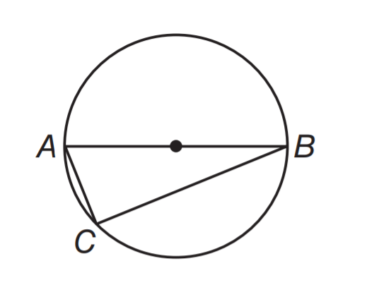

# AVP0405 — Single visual target

MathVista:28 / MathVista:37 · different type · Mathematical roles of graphical elements

## Shared or similar visual information

An unfilled circular outline

## Evidence locations

- Left image: The large unfilled circular outline surrounding A, B and C.
- Right image: The hollow circle on the blue curve directly below the separate filled blue point.

## Mathematical meanings

Left image: The circumference of a geometric circle, rather than an excluded graph point. Right image: A hole: this marked position on the curve is excluded; the separate filled point supplies the function value at the same horizontal coordinate.

## Same mathematical meanings

no

## Rationales

The circle through A and B bounds a complete geometric object; the small circle interrupting g marks a missing graph position. Size is not the basis: the surrounding construction determines their roles.

Only the selected target is annotated. AI visual-review draft; not independently double-annotated by humans.
