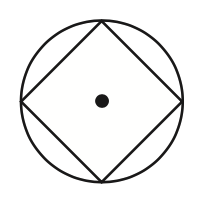

# AVP0406 — Single visual target

MathVista:82 / MathVista:156 · different type · Mathematical roles of graphical elements

## Shared or similar visual information

An unfilled circular outline

## Evidence locations

- Left image: The black circular outline surrounding the inscribed four-sided figure.
- Right image: The hollow circle at the upper end of the sloping straight branch, at x=1.

## Mathematical meanings

Left image: The circumference of the surrounding geometric circle. Right image: The straight branch excludes that endpoint, consistent with the printed restriction x<1.

## Same mathematical meanings

no

## Rationales

The enclosing circle is the boundary of a geometric figure, while the open symbol at x=1 encodes the strict domain restriction of a function branch.

Only the selected target is annotated. AI visual-review draft; not independently double-annotated by humans.
