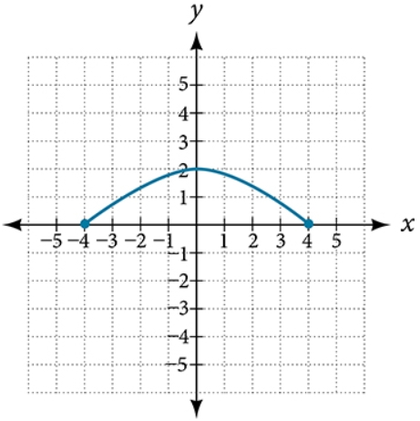

# AVP0407 — Single visual target

MathVista:34 / MathVerse:483 · same type · Mathematical roles of graphical elements

## Shared or similar visual information

A filled circular endpoint marker

## Evidence locations

- Left image: The filled red circle at the right end of the horizontal step at height 5.
- Right image: The filled blue dot at the left endpoint of the arch-shaped curve.

## Mathematical meanings

Left image: An included endpoint of the selected step of the function graph. Right image: An included endpoint of the displayed function graph.

## Same mathematical meanings

yes

## Rationales

Each dot closes the end of a plotted branch, indicating membership of that endpoint in the graph; the first graph has steps and the second a curved arc.

Only the selected target is annotated. AI visual-review draft; not independently double-annotated by humans.
