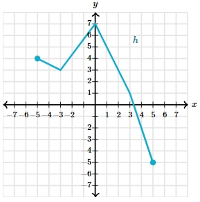

# AVP0408 — Single visual target

MathVista:156 / MathVerse:558 · same type · Mathematical roles of graphical elements

## Shared or similar visual information

A filled circular endpoint marker

## Evidence locations

- Left image: The filled blue circle at the lower branch at x=1, beside the x>=1 branch.
- Right image: The filled cyan circle at the left endpoint of the piecewise-linear graph.

## Mathematical meanings

Left image: An included endpoint of the curved function branch. Right image: An included endpoint of the displayed function graph.

## Same mathematical meanings

yes

## Rationales

The x>=1 annotation confirms inclusion on the left, and the filled endpoint supplies the same inclusion convention on the right.

Only the selected target is annotated. AI visual-review draft; not independently double-annotated by humans.
