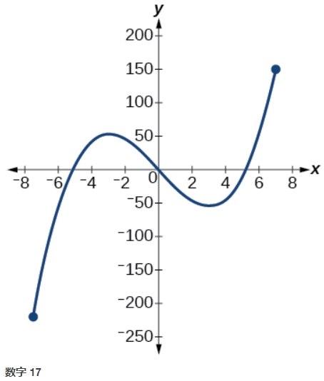
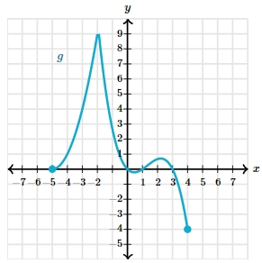

# AVP0409 — Single visual target

MathVerse:491 / MathVerse:559 · same type · Mathematical roles of graphical elements

## Shared or similar visual information

A filled circular endpoint marker

## Evidence locations

- Left image: The filled blue dot at the lower-left endpoint of the curve.
- Right image: The filled cyan circle at the lower-right endpoint of the curve.

## Mathematical meanings

Left image: An included endpoint of the displayed function graph. Right image: An included endpoint of the displayed function graph.

## Same mathematical meanings

yes

## Rationales

Both dots occur where the shown graph ends, so their fill specifically indicates endpoint inclusion rather than merely highlighting an interior coordinate.

Only the selected target is annotated. AI visual-review draft; not independently double-annotated by humans.
