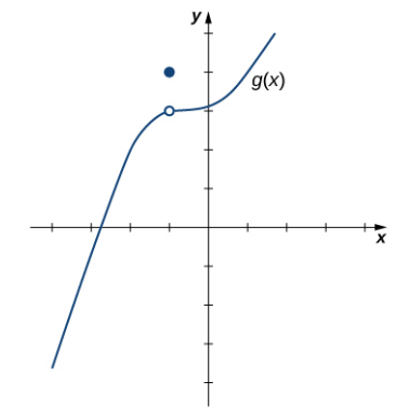
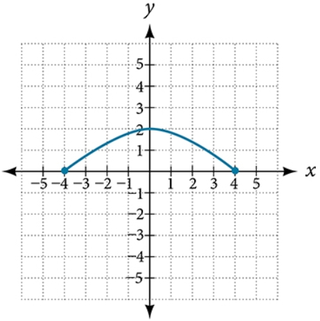

# AVP0410 — Single visual target

MathVista:37 / MathVerse:483 · same type · Mathematical roles of graphical elements

## Shared or similar visual information

A filled circular plotting marker

## Evidence locations

- Left image: The filled blue point directly above the hollow point on g.
- Right image: The filled blue dot at the left endpoint of the arch-shaped curve.

## Mathematical meanings

Left image: The actual function value assigned at that horizontal coordinate, separate from the nearby curve hole. Right image: An included endpoint of the displayed function graph.

## Same mathematical meanings

no

## Rationales

The isolated dot overrides the function value at an interior hole; the other dot closes a domain boundary of the drawn curve. The local positions distinguish value assignment from endpoint closure.

Only the selected target is annotated. AI visual-review draft; not independently double-annotated by humans.
