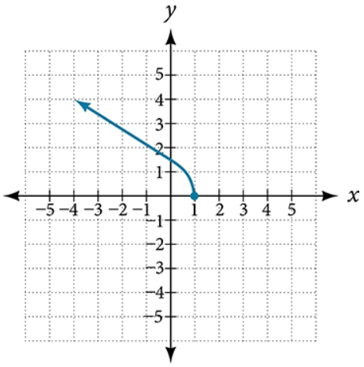

# AVP0411 — Single visual target

MathVista:23 / MathVerse:485 · same type · Mathematical roles of graphical elements

## Shared or similar visual information

A filled circular plotting marker

## Evidence locations

- Left image: The black filled dot at the bottom vertex of the blue V-shaped graph.
- Right image: The filled blue point where the curve ends on the positive horizontal axis.

## Mathematical meanings

Left image: A designated location on the function graph, highlighting its bottom vertex rather than a domain endpoint. Right image: An included endpoint of the displayed function graph.

## Same mathematical meanings

no

## Rationales

The bottom vertex is internal to an ongoing V-shaped graph, while the dot in the other image is where the curve terminates. Highlighting an interior vertex is different from encoding endpoint inclusion.

Only the selected target is annotated. AI visual-review draft; not independently double-annotated by humans.
