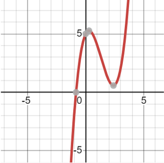
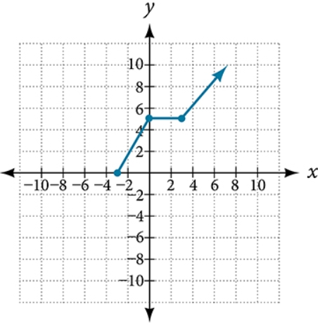

# AVP0412 — Single visual target

MathVista:65 / MathVerse:487 · same type · Mathematical roles of graphical elements

## Shared or similar visual information

A filled circular plotting marker

## Evidence locations

- Left image: The filled gray dot at the local maximum of the red graph.
- Right image: The filled blue dot at the lower-left end of the piecewise graph.

## Mathematical meanings

Left image: A designated interior location on the function curve, highlighting its peak. Right image: An included endpoint of the displayed function graph.

## Same mathematical meanings

no

## Rationales

The gray peak marker is an interior turning-point highlight, whereas the blue dot closes the end of a piecewise graph. Their identical filled form does not identify the same role.

Only the selected target is annotated. AI visual-review draft; not independently double-annotated by humans.
