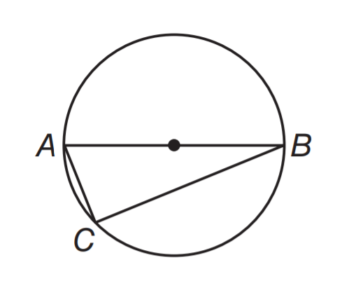
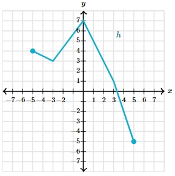

# AVP0413 — Single visual target

MathVista:28 / MathVerse:558 · different type · Mathematical roles of graphical elements

## Shared or similar visual information

A filled circular point marker

## Evidence locations

- Left image: The filled black dot halfway along AB in the circle.
- Right image: The filled cyan circle at the left endpoint of the piecewise-linear graph.

## Mathematical meanings

Left image: The center of the geometric circle. Right image: An included endpoint of the displayed function graph.

## Same mathematical meanings

no

## Rationales

A dot at the middle of a circle diameter identifies a center; a dot at the end of the plotted polyline indicates an included endpoint.

Only the selected target is annotated. AI visual-review draft; not independently double-annotated by humans.
