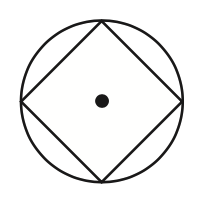
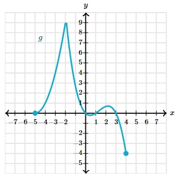

# AVP0414 — Single visual target

MathVista:82 / MathVerse:559 · different type · Mathematical roles of graphical elements

## Shared or similar visual information

A filled circular point marker

## Evidence locations

- Left image: The filled black dot inside the inscribed four-sided figure and circle.
- Right image: The filled cyan circle at the lower-right endpoint of the curve.

## Mathematical meanings

Left image: The center of the surrounding circle. Right image: An included endpoint of the displayed function graph.

## Same mathematical meanings

no

## Rationales

The first dot identifies a circle center inside a closed geometric figure, while the other closes the boundary of a function branch.

Only the selected target is annotated. AI visual-review draft; not independently double-annotated by humans.
