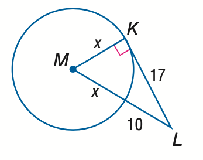
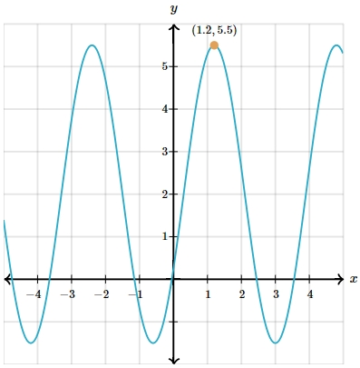

# AVP0415 — Single visual target

MathVista:114 / MathVerse:531 · different type · Mathematical roles of graphical elements

## Shared or similar visual information

A filled circular point marker

## Evidence locations

- Left image: The filled blue point M inside the circle, connected to K and L.
- Right image: The filled orange circle beside the coordinate label (1.2,5.5).

## Mathematical meanings

Left image: The center of the circle from which the two blue segments extend. Right image: A designated point on the curve identified by its Cartesian coordinates.

## Same mathematical meanings

no

## Rationales

M is the origin of radii in the circle construction; the annotated waveform point is used for coordinate reading. Center designation and a sampled curve position are different roles.

Only the selected target is annotated. AI visual-review draft; not independently double-annotated by humans.
