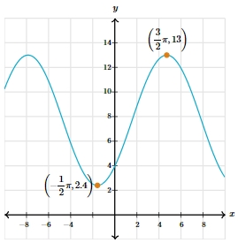

# AVP0417 — Single visual target

MathVista:329 / MathVerse:536 · same type · Mathematical roles of graphical elements

## Shared or similar visual information

A filled point on a coordinate plot

## Evidence locations

- Left image: The filled black dot on the logarithmic graph above the tick x=4.
- Right image: The filled orange circle at the upper marked peak, with a coordinate annotation.

## Mathematical meanings

Left image: A designated coordinate position on the function graph. Right image: A designated coordinate position on the function graph.

## Same mathematical meanings

yes

## Rationales

Both dots pick out coordinate positions on the drawn function curves; logarithmic shape versus oscillation does not change the selected marker function.

Only the selected target is annotated. AI visual-review draft; not independently double-annotated by humans.
