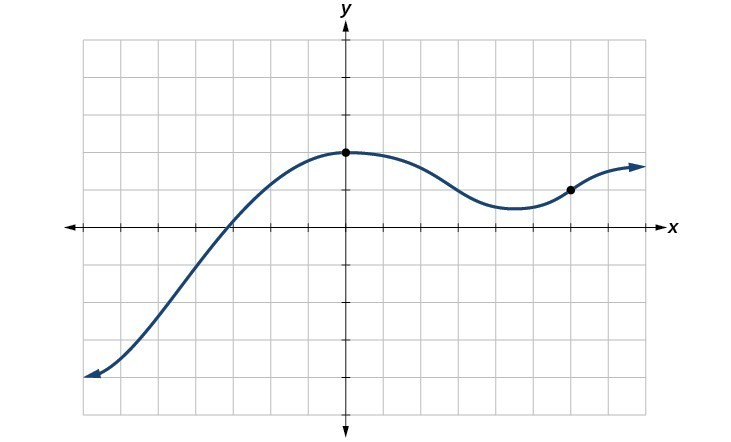
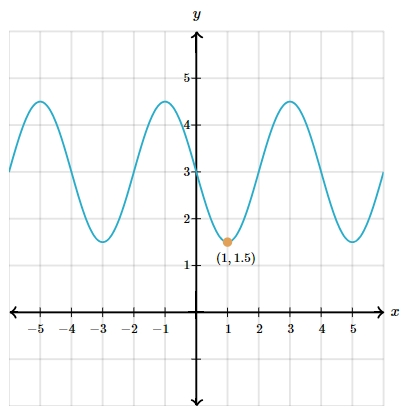

# AVP0418 — Single visual target

MathVista:686 / MathVerse:541 · same type · Mathematical roles of graphical elements

## Shared or similar visual information

A filled point at an interior curve location

## Evidence locations

- Left image: The filled black dot at the crest of the blue curve on the vertical axis.
- Right image: The filled orange circle at the trough beside (1,1.5).

## Mathematical meanings

Left image: A designated interior position on the function graph. Right image: A designated interior position on the function graph.

## Same mathematical meanings

yes

## Rationales

The dots highlight positions within continuing curves. Being on a peak in one image and a trough in the other does not change their common position-marking role.

Only the selected target is annotated. AI visual-review draft; not independently double-annotated by humans.
