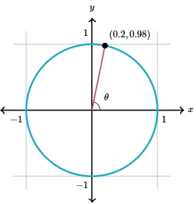

# AVP0419 — Single visual target

MathVista:23 / MathVerse:556 · different type · Mathematical roles of graphical elements

## Shared or similar visual information

A filled dot on a drawn curve

## Evidence locations

- Left image: The black filled dot at the bottom vertex of the blue V-shaped graph.
- Right image: The filled black point on the circle beside (0.2,0.98).

## Mathematical meanings

Left image: A designated location on the function graph, highlighting its bottom vertex rather than a domain endpoint. Right image: A designated coordinate position on the geometric circle.

## Same mathematical meanings

yes

## Rationales

Both selected dots locate a designated position on the principal curve; the marker itself is not an endpoint closure in either image.

Only the selected target is annotated. AI visual-review draft; not independently double-annotated by humans.
