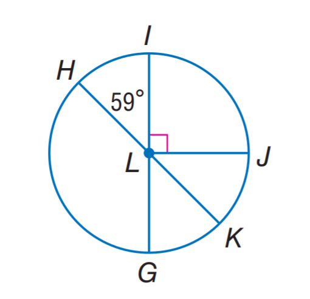
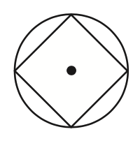

# AVP0420 — Single visual target

MathVista:300 / MathVista:82 · same type · Mathematical roles of graphical elements

## Shared or similar visual information

A filled dot inside a circular outline

## Evidence locations

- Left image: The filled blue point L at the intersection of the circle radii.
- Right image: The filled black dot inside the inscribed four-sided figure and circle.

## Mathematical meanings

Left image: The center of the geometric circle. Right image: The center of the surrounding circle.

## Same mathematical meanings

yes

## Rationales

Both dots occupy the circle center and serve as the reference location for the surrounding circle; they do not represent observations on a function graph.

Only the selected target is annotated. AI visual-review draft; not independently double-annotated by humans.
