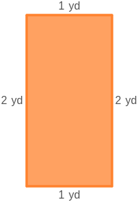
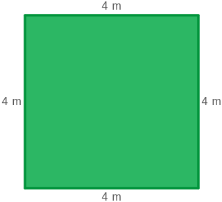

# AVP0421 — Single visual target

MathVista:56 / MathVista:67 · same type · Mathematical roles of graphical elements

## Shared or similar visual information

A filled polygonal interior

## Evidence locations

- Left image: The orange interior of the rectangle labeled 1 yd across and 2 yd vertically.
- Right image: The green interior of the square with 4 m side labels.

## Mathematical meanings

Left image: The interior area of the displayed geometric rectangle. Right image: The interior area of the displayed geometric square.

## Same mathematical meanings

yes

## Rationales

The side-length labels and closed boundaries show that both fills identify geometric plane regions whose area can be measured; their color and shape differ.

Only the selected target is annotated. AI visual-review draft; not independently double-annotated by humans.
