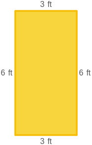
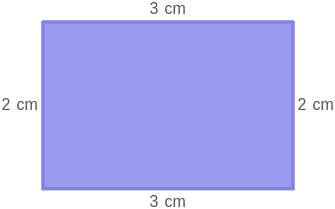

# AVP0422 — Single visual target

MathVista:71 / MathVista:606 · same type · Mathematical roles of graphical elements

## Shared or similar visual information

A filled rectangular interior

## Evidence locations

- Left image: The yellow interior of the rectangle labeled 3 ft and 6 ft.
- Right image: The purple interior of the rectangle labeled 3 cm and 2 cm.

## Mathematical meanings

Left image: The interior area of the displayed geometric rectangle. Right image: The interior area of the displayed geometric rectangle.

## Same mathematical meanings

yes

## Rationales

Both fills cover the rectangle enclosed by its dimension-labeled sides, so the target is the geometric area of a rectangle in each image.

Only the selected target is annotated. AI visual-review draft; not independently double-annotated by humans.
