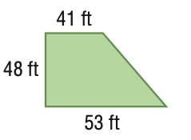
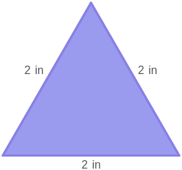

# AVP0423 — Single visual target

MathVista:318 / MathVista:399 · same type · Mathematical roles of graphical elements

## Shared or similar visual information

A filled polygonal interior

## Evidence locations

- Left image: The green interior of the trapezoid with side-length labels.
- Right image: The purple filled triangle with three 2 in side labels.

## Mathematical meanings

Left image: The interior area of the displayed plane polygon. Right image: The interior area of the displayed plane polygon.

## Same mathematical meanings

yes

## Rationales

The complete closed polygon is filled in both diagrams. The fill selects its plane area rather than a local angle or an unbounded solution set.

Only the selected target is annotated. AI visual-review draft; not independently double-annotated by humans.
