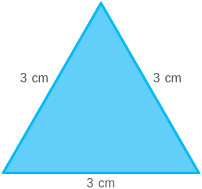
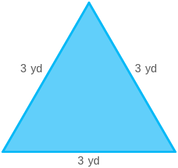

# AVP0424 — Single visual target

MathVista:441 / MathVista:712 · same type · Mathematical roles of graphical elements

## Shared or similar visual information

A filled triangular interior

## Evidence locations

- Left image: The blue filled triangle with three 3 cm side labels.
- Right image: The cyan filled triangle with three 3 yd side labels.

## Mathematical meanings

Left image: The interior area of the displayed plane triangle. Right image: The interior area of the displayed plane triangle.

## Same mathematical meanings

yes

## Rationales

Each colored patch is the whole triangular region bounded by the three length-labeled sides; differences in units do not alter the fill role.

Only the selected target is annotated. AI visual-review draft; not independently double-annotated by humans.
