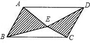
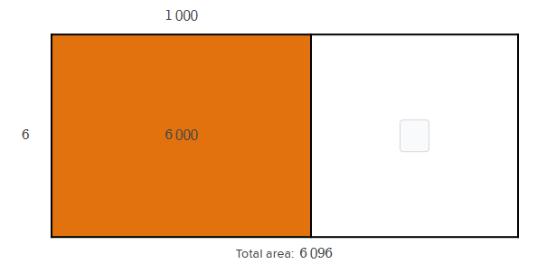

# AVP0425 — Single visual target

MathVista:635 / MathVerse:421 · same type · Mathematical roles of graphical elements

## Shared or similar visual information

A filled or hatched subregion of a larger polygon

## Evidence locations

- Left image: One of the two hatched triangular parts inside parallelogram ABCD.
- Right image: The orange rectangular part labeled 6 000 in the area model.

## Mathematical meanings

Left image: A selected geometric subregion whose plane area is distinguished from the unhatched parts. Right image: A selected geometric subregion whose plane area is distinguished from the other rectangular part.

## Same mathematical meanings

yes

## Rationales

The fill separates a particular geometric area from neighboring unfilled or differently filled areas in both constructions. It is a region-selection cue rather than an angle annotation.

Only the selected target is annotated. AI visual-review draft; not independently double-annotated by humans.
