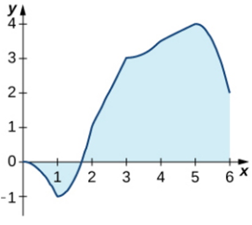

# AVP0426 — Single visual target

MathVista:260 / MathVista:671 · same type · Mathematical roles of graphical elements

## Shared or similar visual information

A shaded region between a function curve and the horizontal axis

## Evidence locations

- Left image: The light-blue fill between the function curve and the horizontal axis, to the right of its positive zero.
- Right image: The shaded part below the curved graph and above the horizontal axis between x=3 and x=6.

## Mathematical meanings

Left image: A region between a function graph and the horizontal axis, selected as an area under the graph. Right image: A selected area under a function graph over a restricted horizontal interval.

## Same mathematical meanings

yes

## Rationales

Both patches are bounded vertically by the graph and horizontal axis over a selected interval; the fill represents graph-based area, even though the curve shapes differ.

Only the selected target is annotated. AI visual-review draft; not independently double-annotated by humans.
