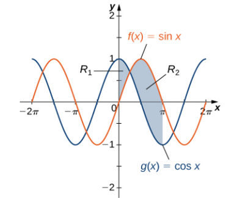
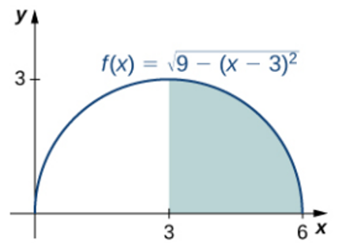

# AVP0427 — Single visual target

MathVista:287 / MathVista:926 · same type · Mathematical roles of graphical elements

## Shared or similar visual information

A shaded region bounded by a function graph

## Evidence locations

- Left image: The gray region labeled R2, between the sine and cosine curves to the right of their upper intersection.
- Right image: The blue shaded region below the arch-shaped function graph, to the right of x=3.

## Mathematical meanings

Left image: A selected area between the sine and cosine graphs in the region labeled R2. Right image: A selected area under a function graph over a restricted horizontal interval.

## Same mathematical meanings

yes

## Rationales

Both fills select regions for graph-based area measurement. The additional graph forms the other boundary on the left, while the axis forms it on the right.

Only the selected target is annotated. AI visual-review draft; not independently double-annotated by humans.
