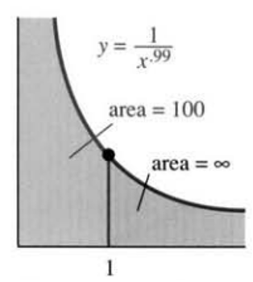
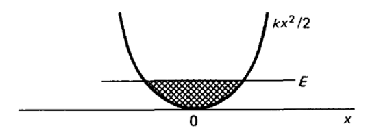

# AVP0428 — Single visual target

MathVista:717 / MathVista:997 · same type · Mathematical roles of graphical elements

## Shared or similar visual information

A filled region next to a function curve

## Evidence locations

- Left image: The gray area below the reciprocal-power curve to the right of the vertical line at x=1.
- Right image: The hatched region between the horizontal level E and the bottom part of the U-shaped curve.

## Mathematical meanings

Left image: An unbounded-horizontal-interval region under the function graph, annotated as an infinite area. Right image: A selected bounded region between a function curve and a horizontal level.

## Same mathematical meanings

yes

## Rationales

Both use fill to identify a region whose area is bounded vertically by a function curve and a reference line. Bounded versus unbounded horizontal extent changes the area problem, not the region-selecting role.

Only the selected target is annotated. AI visual-review draft; not independently double-annotated by humans.
