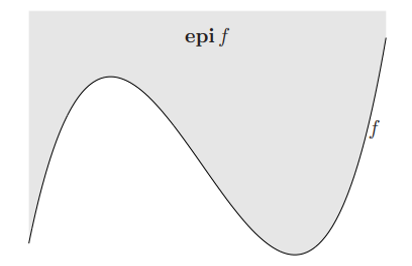
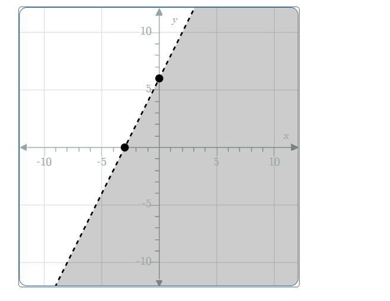

# AVP0429 — Single visual target

MathVista:235 / MathVerse:511 · same type · Mathematical roles of graphical elements

## Shared or similar visual information

A shaded region on one side of a graph

## Evidence locations

- Left image: The gray region above the curve labeled f, marked epi f.
- Right image: The gray half-plane on one side of the rising dashed line.

## Mathematical meanings

Left image: The epigraph: the set of coordinate pairs on or above the function graph. Right image: A coordinate-plane solution region of a linear inequality; the dashed boundary is excluded.

## Same mathematical meanings

yes

## Rationales

The label epi f specifies a set of points above f, while half-plane shading identifies points satisfying a linear inequality. Both fills encode an inequality-defined coordinate set; their boundary-inclusion details need not match.

Only the selected target is annotated. AI visual-review draft; not independently double-annotated by humans.
