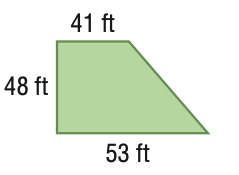

# AVP0430 — Single visual target

MathVista:273 / MathVista:318 · same type · Mathematical roles of graphical elements

## Shared or similar visual information

A filled polygonal interior

## Evidence locations

- Left image: The blue interior of the diamond-shaped quadrilateral with dashed diagonals.
- Right image: The green interior of the trapezoid with side-length labels.

## Mathematical meanings

Left image: The interior area of the displayed plane polygon. Right image: The interior area of the displayed plane polygon.

## Same mathematical meanings

yes

## Rationales

The blue diamond and green trapezoid each use fill for the entire interior plane region, with dimensions attached to the surrounding geometric construction.

Only the selected target is annotated. AI visual-review draft; not independently double-annotated by humans.
