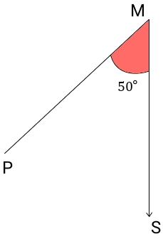

# AVP0431 — Single visual target

MathVista:56 / MathVerse:332 · same type · Mathematical roles of graphical elements

## Shared or similar visual information

A colored filled region

## Evidence locations

- Left image: The orange interior of the rectangle labeled 1 yd across and 2 yd vertically.
- Right image: The red angle region marked 50 degrees at M.

## Mathematical meanings

Left image: The interior area of the displayed geometric rectangle. Right image: A colored annotation selecting the interior of the angle between two rays.

## Same mathematical meanings

no

## Rationales

The first patch occupies a rectangle whose sides carry length units; the second occupies only the wedge between two rays and is labeled in degrees. Area selection and angle highlighting have different mathematical roles.

Only the selected target is annotated. AI visual-review draft; not independently double-annotated by humans.
