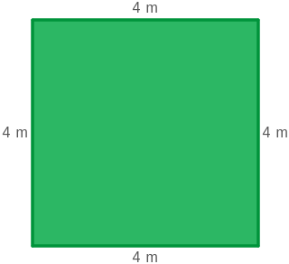
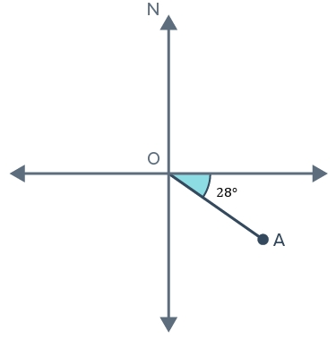

# AVP0432 — Single visual target

MathVista:67 / MathVerse:334 · same type · Mathematical roles of graphical elements

## Shared or similar visual information

A colored filled region

## Evidence locations

- Left image: The green interior of the square with 4 m side labels.
- Right image: The cyan angle region labeled 28 degrees at O.

## Mathematical meanings

Left image: The interior area of the displayed geometric square. Right image: A colored annotation selecting the interior of an angle between a reference ray and OA.

## Same mathematical meanings

no

## Rationales

Filling a whole square selects a two-dimensional geometric area, whereas filling a small wedge at O selects an angle relative to a bearing reference.

Only the selected target is annotated. AI visual-review draft; not independently double-annotated by humans.
