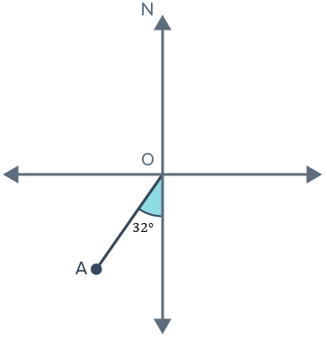

# AVP0433 — Single visual target

MathVista:273 / MathVerse:335 · same type · Mathematical roles of graphical elements

## Shared or similar visual information

A colored filled region

## Evidence locations

- Left image: The blue interior of the diamond-shaped quadrilateral with dashed diagonals.
- Right image: The cyan region labeled 32 degrees at O.

## Mathematical meanings

Left image: The interior area of the displayed plane polygon. Right image: A colored annotation selecting an angle between two rays.

## Same mathematical meanings

no

## Rationales

The diamond interior is an area region, while the small wedge with a degree measure is an angle annotation; the same filling operation encodes different quantities.

Only the selected target is annotated. AI visual-review draft; not independently double-annotated by humans.
