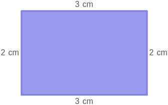
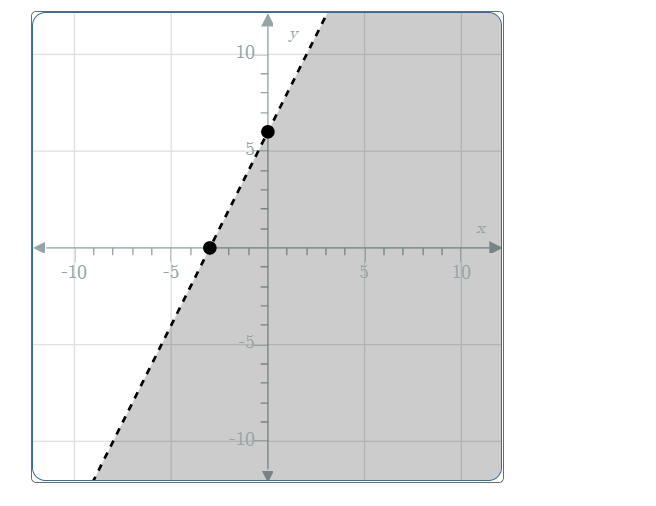

# AVP0434 — Single visual target

MathVista:606 / MathVerse:511 · different type · Mathematical roles of graphical elements

## Shared or similar visual information

A shaded two-dimensional region

## Evidence locations

- Left image: The purple interior of the rectangle labeled 3 cm and 2 cm.
- Right image: The gray half-plane on one side of the rising dashed line.

## Mathematical meanings

Left image: The interior area of the displayed geometric rectangle. Right image: A coordinate-plane solution region of a linear inequality; the dashed boundary is excluded.

## Same mathematical meanings

no

## Rationales

The rectangle fill identifies a bounded geometric object with centimeter dimensions. The half-plane fill denotes all coordinate pairs satisfying an inequality, rather than the area of a dimensioned polygon.

Only the selected target is annotated. AI visual-review draft; not independently double-annotated by humans.
