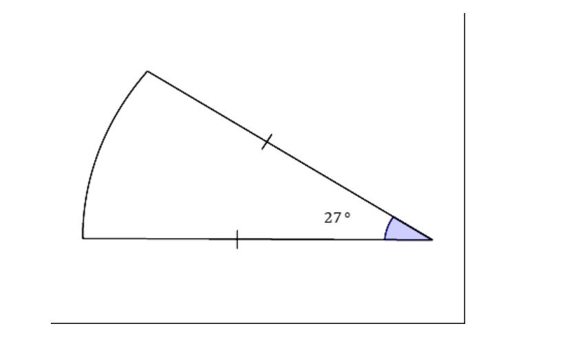

# AVP0435 — Single visual target

MathVista:671 / MathVerse:413 · different type · Mathematical roles of graphical elements

## Shared or similar visual information

A colored filled region

## Evidence locations

- Left image: The shaded part below the curved graph and above the horizontal axis between x=3 and x=6.
- Right image: The purple angle region labeled 27 degrees at the lower-right corner.

## Mathematical meanings

Left image: A selected area under a function graph over a restricted horizontal interval. Right image: A colored annotation selecting the interior of an angle.

## Same mathematical meanings

no

## Rationales

The first fill is under a function graph on an x-interval; the second identifies a 27-degree angle at a vertex. The nearby axes versus rays establish distinct roles.

Only the selected target is annotated. AI visual-review draft; not independently double-annotated by humans.
