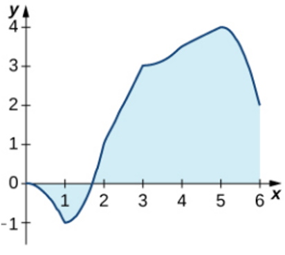

# AVP0436 — Single visual target

MathVista:260 / MathVerse:331 · different type · Mathematical roles of graphical elements

## Shared or similar visual information

A colored filled region

## Evidence locations

- Left image: The light-blue fill between the function curve and the horizontal axis, to the right of its positive zero.
- Right image: The red sector labeled 45 degrees at A between AP and AN.

## Mathematical meanings

Left image: A region between a function graph and the horizontal axis, selected as an area under the graph. Right image: A colored annotation selecting the interior of the angle between two rays.

## Same mathematical meanings

no

## Rationales

One patch lies between a function curve and an axis and selects graph-based area; the other is a degree-labeled angular wedge between rays.

Only the selected target is annotated. AI visual-review draft; not independently double-annotated by humans.
