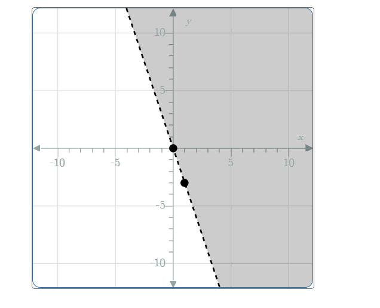

# AVP0437 — Single visual target

MathVista:441 / MathVerse:512 · different type · Mathematical roles of graphical elements

## Shared or similar visual information

A filled region with a straight boundary

## Evidence locations

- Left image: The blue filled triangle with three 3 cm side labels.
- Right image: The gray half-plane beside the descending dashed line.

## Mathematical meanings

Left image: The interior area of the displayed plane triangle. Right image: A coordinate-plane solution region of a linear inequality.

## Same mathematical meanings

no

## Rationales

The blue triangle fill selects the interior of a finite geometric figure; the gray half-plane describes an inequality solution set extending across the coordinate plane.

Only the selected target is annotated. AI visual-review draft; not independently double-annotated by humans.
