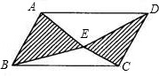
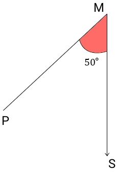

# AVP0438 — Single visual target

MathVista:635 / MathVerse:332 · same type · Mathematical roles of graphical elements

## Shared or similar visual information

Hatching or color used to fill a selected region

## Evidence locations

- Left image: One of the two hatched triangular parts inside parallelogram ABCD.
- Right image: The red angle region marked 50 degrees at M.

## Mathematical meanings

Left image: A selected geometric subregion whose plane area is distinguished from the unhatched parts. Right image: A colored annotation selecting the interior of the angle between two rays.

## Same mathematical meanings

no

## Rationales

The hatched triangle is a subarea inside a parallelogram. The red wedge is an angle marker between rays. The local boundaries show area-partition and angle-selection roles respectively.

Only the selected target is annotated. AI visual-review draft; not independently double-annotated by humans.
