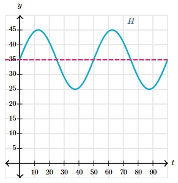

# AVP0439 — Single visual target

MathVista:592 / MathVerse:548 · same type · Mathematical roles of graphical elements

## Shared or similar visual information

A horizontal dashed line crossing a curve

## Evidence locations

- Left image: The orange horizontal dashed line crossing the oscillating curve above the x-axis.
- Right image: The magenta horizontal dashed line through the level 35.

## Mathematical meanings

Left image: A fixed-height reference line in the coordinate system. Right image: A fixed-height reference line in the coordinate system.

## Same mathematical meanings

yes

## Rationales

Both lines hold a constant vertical coordinate and provide a level for comparing the oscillating graph; neither is itself a varying function curve.

Only the selected target is annotated. AI visual-review draft; not independently double-annotated by humans.
