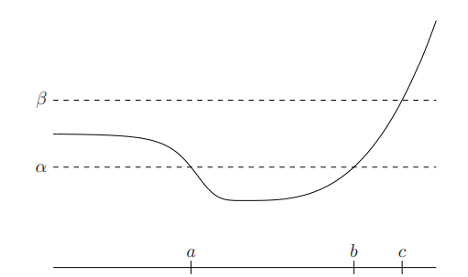
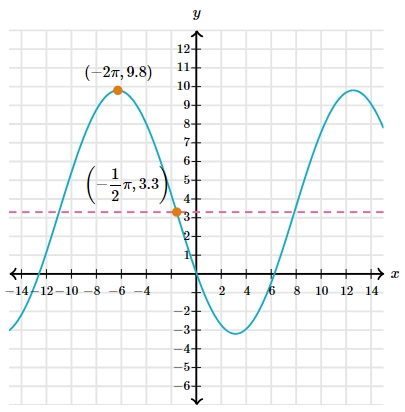

# AVP0440 — Single visual target

MathVista:723 / MathVerse:542 · same type · Mathematical roles of graphical elements

## Shared or similar visual information

A horizontal dashed line near a function curve

## Evidence locations

- Left image: The upper horizontal dashed line labeled beta.
- Right image: The magenta horizontal dashed line passing through the marked point on the descending curve.

## Mathematical meanings

Left image: A fixed vertical-level reference used to compare the curve with a selected height. Right image: A fixed vertical-level reference used for coordinate comparison.

## Same mathematical meanings

yes

## Rationales

The beta label and the marked-point guide identify fixed y-levels. The dashes provide reference heights rather than encode excluded graph boundaries.

Only the selected target is annotated. AI visual-review draft; not independently double-annotated by humans.
