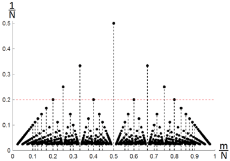

# AVP0441 — Single visual target

MathVista:738 / MathVerse:535 · same type · Mathematical roles of graphical elements

## Shared or similar visual information

A horizontal dashed reference across a coordinate plot

## Evidence locations

- Left image: The red horizontal dashed reference line through the tick 0.2.
- Right image: The magenta horizontal dashed line through the marked point on the descending waveform.

## Mathematical meanings

Left image: A fixed-height reference against which plotted points can be compared. Right image: A fixed-y horizontal reference for locating a curve point.

## Same mathematical meanings

yes

## Rationales

The red line through 0.2 and the magenta line through the marked waveform point each establish a constant ordinate for comparison with plotted positions.

Only the selected target is annotated. AI visual-review draft; not independently double-annotated by humans.
