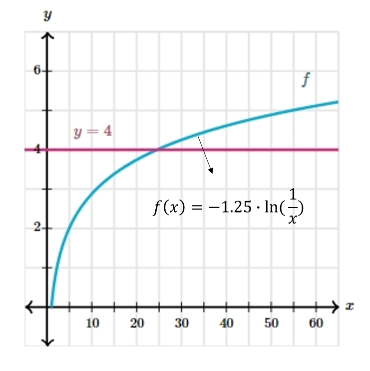

# AVP0443 — Single visual target

MathVista:137 / MathVerse:622 · same type · Mathematical roles of graphical elements

## Shared or similar visual information

A horizontal colored line crossing a function graph

## Evidence locations

- Left image: The upper orange horizontal line cutting the graph f(x)=x^2.
- Right image: The magenta horizontal line labeled y=4 crossing the cyan curve.

## Mathematical meanings

Left image: A fixed-y horizontal comparison line across the function graph. Right image: A fixed-y horizontal comparison line across the function graph.

## Same mathematical meanings

yes

## Rationales

The orange line and the line explicitly labeled y=4 provide constant-y comparison levels; their exact heights are not the selected target.

Only the selected target is annotated. AI visual-review draft; not independently double-annotated by humans.
