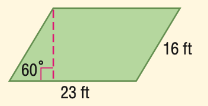
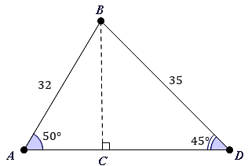

# AVP0444 — Single visual target

MathVista:737 / MathVerse:354 · same type · Mathematical roles of graphical elements

## Shared or similar visual information

A vertical dashed segment within a geometric figure

## Evidence locations

- Left image: The pink vertical dashed segment from the upper-left vertex to the lower side of the parallelogram, ending at a right-angle box.
- Right image: The vertical dashed segment from B to C on the triangle base, ending at a right-angle box.

## Mathematical meanings

Left image: A perpendicular height construction from a vertex to the opposite horizontal side. Right image: A perpendicular height construction from a vertex to the base.

## Same mathematical meanings

yes

## Rationales

Each segment joins a vertex to a horizontal side with a right-angle box at the foot, establishing the same height construction.

Only the selected target is annotated. AI visual-review draft; not independently double-annotated by humans.
