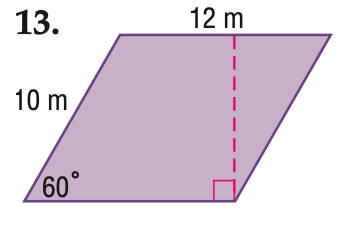
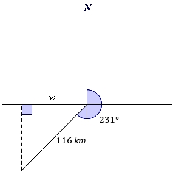

# AVP0445 — Single visual target

MathVista:822 / MathVerse:345 · same type · Mathematical roles of graphical elements

## Shared or similar visual information

A vertical dashed segment with a perpendicular foot

## Evidence locations

- Left image: The pink vertical dashed segment inside the parallelogram, ending at a right-angle box on the base.
- Right image: The vertical dashed segment at the left of the geometric construction, ending at a right-angle box on the horizontal reference.

## Mathematical meanings

Left image: A perpendicular height construction between the horizontal sides. Right image: A perpendicular height/projection construction between two geometric positions.

## Same mathematical meanings

yes

## Rationales

The right-angle foot and connection between geometric positions identify a finite height/projection construction in each image, unlike an asymptote.

Only the selected target is annotated. AI visual-review draft; not independently double-annotated by humans.
