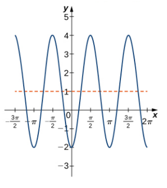
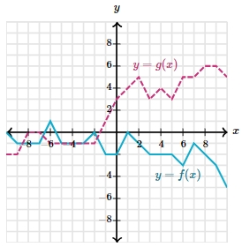

# AVP0446 — Single visual target

MathVista:592 / MathVerse:557 · same type · Mathematical roles of graphical elements

## Shared or similar visual information

A dashed line in a coordinate plot

## Evidence locations

- Left image: The orange horizontal dashed line crossing the oscillating curve above the x-axis.
- Right image: The magenta dashed polyline labeled y=g(x).

## Mathematical meanings

Left image: A fixed-height reference line in the coordinate system. Right image: The graph of a second function, distinguished by dash style.

## Same mathematical meanings

no

## Rationales

The straight horizontal line is a constant-height guide for the main waveform; the labeled varying dashed polyline is the actual graph of g.

Only the selected target is annotated. AI visual-review draft; not independently double-annotated by humans.
