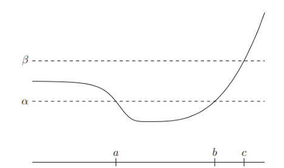

# AVP0447 — Single visual target

MathVista:723 / MathVerse:568 · same type · Mathematical roles of graphical elements

## Shared or similar visual information

A dashed line in a coordinate plot

## Evidence locations

- Left image: The upper horizontal dashed line labeled beta.
- Right image: The magenta dashed U-shaped curve labeled g.

## Mathematical meanings

Left image: A fixed vertical-level reference used to compare the curve with a selected height. Right image: The graph of a second function, distinguished by dash style.

## Same mathematical meanings

no

## Rationales

The beta line marks one fixed ordinate for comparison, whereas the U-shaped line encodes varying values of a second function.

Only the selected target is annotated. AI visual-review draft; not independently double-annotated by humans.
