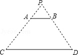
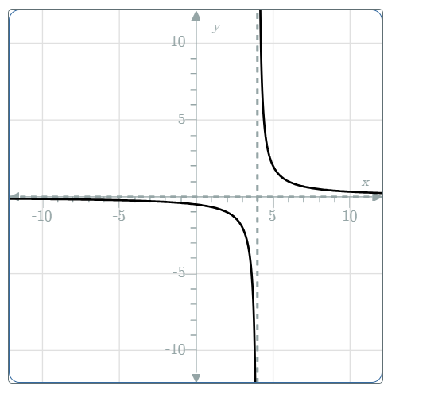

# AVP0449 — Single visual target

MathVista:708 / MathVerse:582 · different type · Mathematical roles of graphical elements

## Shared or similar visual information

A dashed construction line

## Evidence locations

- Left image: The dashed sloping line from the top vertex P through A toward C.
- Right image: The gray vertical dashed line between the two branches to the right of the vertical axis.

## Mathematical meanings

Left image: A geometric side extension making the larger triangle construction visible. Right image: A vertical asymptote approached by the function graph.

## Same mathematical meanings

no

## Rationales

The sloping dashed line extends a finite triangle side; the vertical dashed line in the function plot marks limiting behavior of branches. The shared dash style does not make these roles equivalent.

Only the selected target is annotated. AI visual-review draft; not independently double-annotated by humans.
