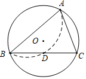
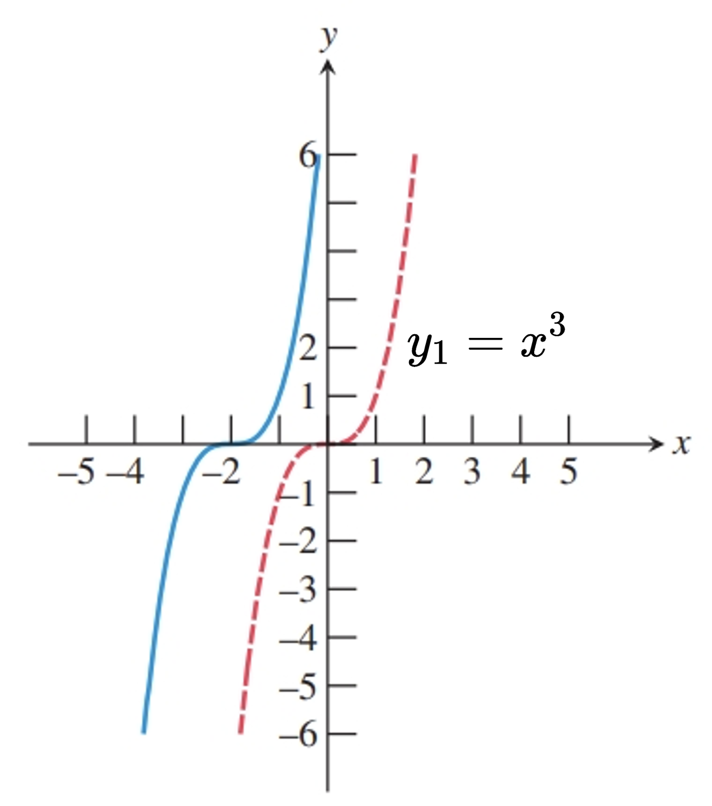

# AVP0450 — Single visual target

MathVista:700 / MathVerse:599 · different type · Mathematical roles of graphical elements

## Shared or similar visual information

A curved dashed line

## Evidence locations

- Left image: The dashed curved arc from B toward A inside the main circle.
- Right image: The red dashed curve labeled y1=x^3.

## Mathematical meanings

Left image: An auxiliary curved construction within a geometric circle diagram. Right image: The graph of a function, distinguished from the solid curve by dash style.

## Same mathematical meanings

no

## Rationales

The inner dashed arc assists a circle construction; the red dashed curve is explicitly labeled as a function graph. The local diagram determines auxiliary versus graph roles.

Only the selected target is annotated. AI visual-review draft; not independently double-annotated by humans.
