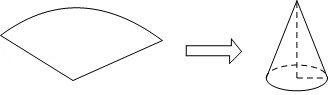
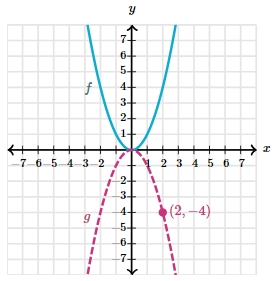

# AVP0451 — Single visual target

MathVista:33 / MathVerse:571 · different type · Mathematical roles of graphical elements

## Shared or similar visual information

A curved dashed line

## Evidence locations

- Left image: The dashed curved arc at the back of the cone base.
- Right image: The magenta dashed downward-opening curve labeled g.

## Mathematical meanings

Left image: A hidden portion of the circular base edge in a three-dimensional cone drawing. Right image: The graph of a second function, distinguished by dash style.

## Same mathematical meanings

no

## Rationales

The rear arc of the cone base is dashed because it is hidden from view; the parabola is dashed to distinguish g from f. Occlusion and function identification are different conventions.

Only the selected target is annotated. AI visual-review draft; not independently double-annotated by humans.
