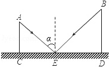
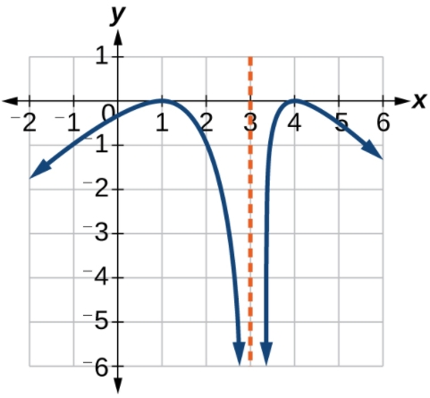

# AVP0452 — Single visual target

MathVista:186 / MathVerse:489 · different type · Mathematical roles of graphical elements

## Shared or similar visual information

A vertical dashed line

## Evidence locations

- Left image: The vertical dashed line above E between the two reflected/sloping segments.
- Right image: The orange vertical dashed line at x=3 between the two curve branches.

## Mathematical meanings

Left image: A perpendicular normal reference to the horizontal surface at E. Right image: A vertical asymptote approached by the function graph.

## Same mathematical meanings

no

## Rationales

The first is the normal to a physical horizontal surface at E. The second marks a vertical line approached by function branches; its meaning is not a surface normal.

Only the selected target is annotated. AI visual-review draft; not independently double-annotated by humans.
