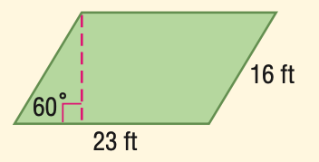
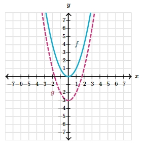

# AVP0453 — Single visual target

MathVista:737 / MathVerse:569 · different type · Mathematical roles of graphical elements

## Shared or similar visual information

A dashed line inside a diagram

## Evidence locations

- Left image: The pink vertical dashed segment from the upper-left vertex to the lower side of the parallelogram, ending at a right-angle box.
- Right image: The magenta dashed U-shaped curve labeled g.

## Mathematical meanings

Left image: A perpendicular height construction from a vertex to the opposite horizontal side. Right image: The graph of a second function, distinguished by dash style.

## Same mathematical meanings

no

## Rationales

The short vertical segment constructs the height of a parallelogram, while the U-shaped dashed line is a second function graph.

Only the selected target is annotated. AI visual-review draft; not independently double-annotated by humans.
