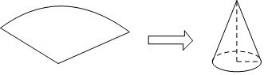
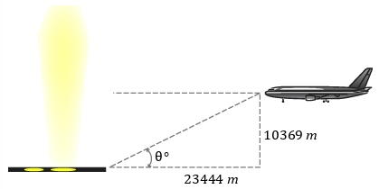

# AVP0454 — Single visual target

MathVista:33 / MathVerse:365 · different type · Mathematical roles of graphical elements

## Shared or similar visual information

A dashed line in a geometric drawing

## Evidence locations

- Left image: The dashed curved arc at the back of the cone base.
- Right image: The vertical dashed segment between the airplane and the ground, labeled 10369 m.

## Mathematical meanings

Left image: A hidden portion of the circular base edge in a three-dimensional cone drawing. Right image: A geometric height projection onto the horizontal ground.

## Same mathematical meanings

no

## Rationales

In the cone, dashes hide the rear base edge; in the airplane diagram, they construct a visible height projection. Both are geometric diagrams but the dash convention differs.

Only the selected target is annotated. AI visual-review draft; not independently double-annotated by humans.
