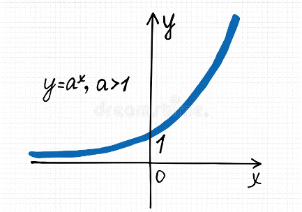
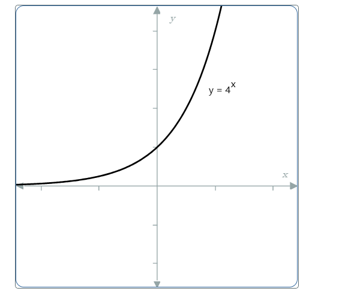

# AVP0455 — Single visual target

MathVista:39 / MathVerse:516 · same type · Mathematical roles of graphical elements

## Shared or similar visual information

The principal smooth curve in a coordinate plot

## Evidence locations

- Left image: The blue increasing curve next to the formula y=a^x, a>1.
- Right image: The black increasing curve labeled y=4^x.

## Mathematical meanings

Left image: A function graph relating y to x. Right image: A function graph relating y to x.

## Same mathematical meanings

yes

## Rationales

Both principal curves are explicitly labeled exponential y-expressions; their x and y positions encode corresponding input-output values.

Only the selected target is annotated. AI visual-review draft; not independently double-annotated by humans.
