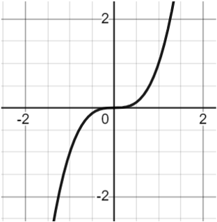
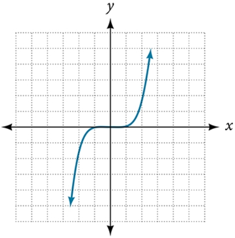

# AVP0456 — Single visual target

MathVista:120 / MathVerse:477 · same type · Mathematical roles of graphical elements

## Shared or similar visual information

An S-shaped curve crossing Cartesian axes

## Evidence locations

- Left image: The black S-shaped curve crossing the origin in the coordinate grid.
- Right image: The blue S-shaped graph with arrows at its ends.

## Mathematical meanings

Left image: A function graph relating y to x. Right image: A function graph relating y to x.

## Same mathematical meanings

yes

## Rationales

Both curves are drawn as the principal y-versus-x graph. Their similar form is interpreted in the shared coordinate context, without claiming identical formulas.

Only the selected target is annotated. AI visual-review draft; not independently double-annotated by humans.
