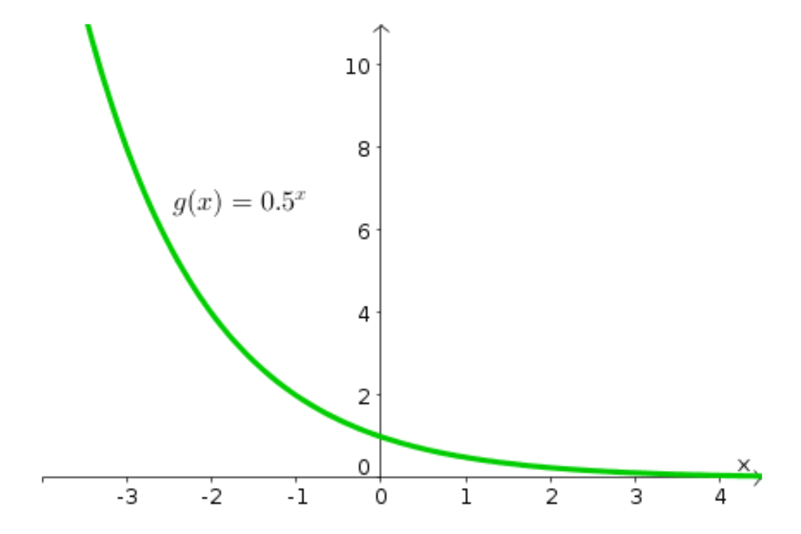
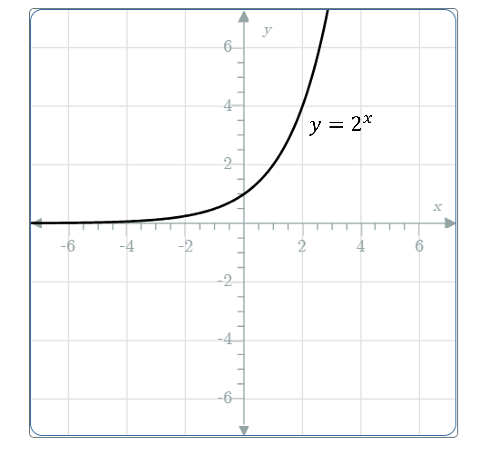

# AVP0457 — Single visual target

MathVista:154 / MathVerse:518 · same type · Mathematical roles of graphical elements

## Shared or similar visual information

A smooth curve in a coordinate system

## Evidence locations

- Left image: The green curve labeled g(x)=0.5^x.
- Right image: The black increasing curve labeled y=2^x.

## Mathematical meanings

Left image: A function graph relating y to x. Right image: A function graph relating y to x.

## Same mathematical meanings

yes

## Rationales

The printed g(x) and y expressions identify function graphs in both images; increasing versus decreasing behavior does not change the graph-representation role.

Only the selected target is annotated. AI visual-review draft; not independently double-annotated by humans.
